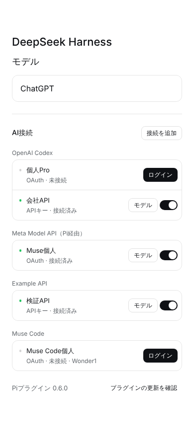
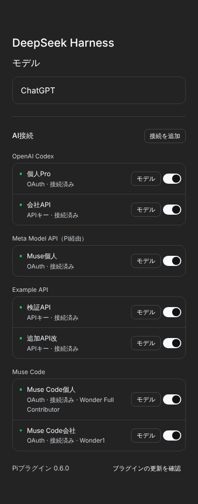
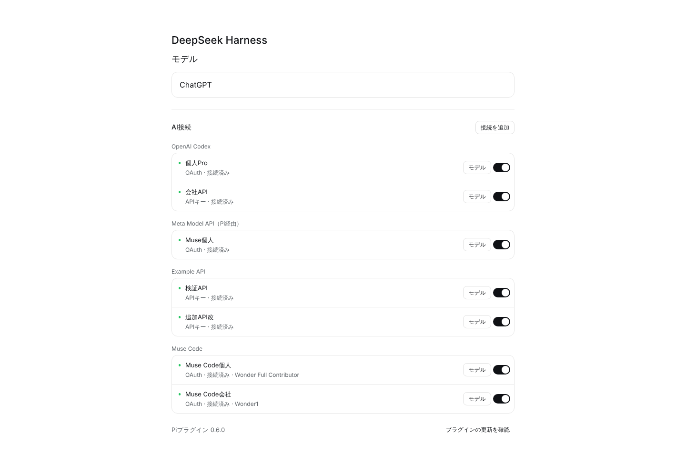
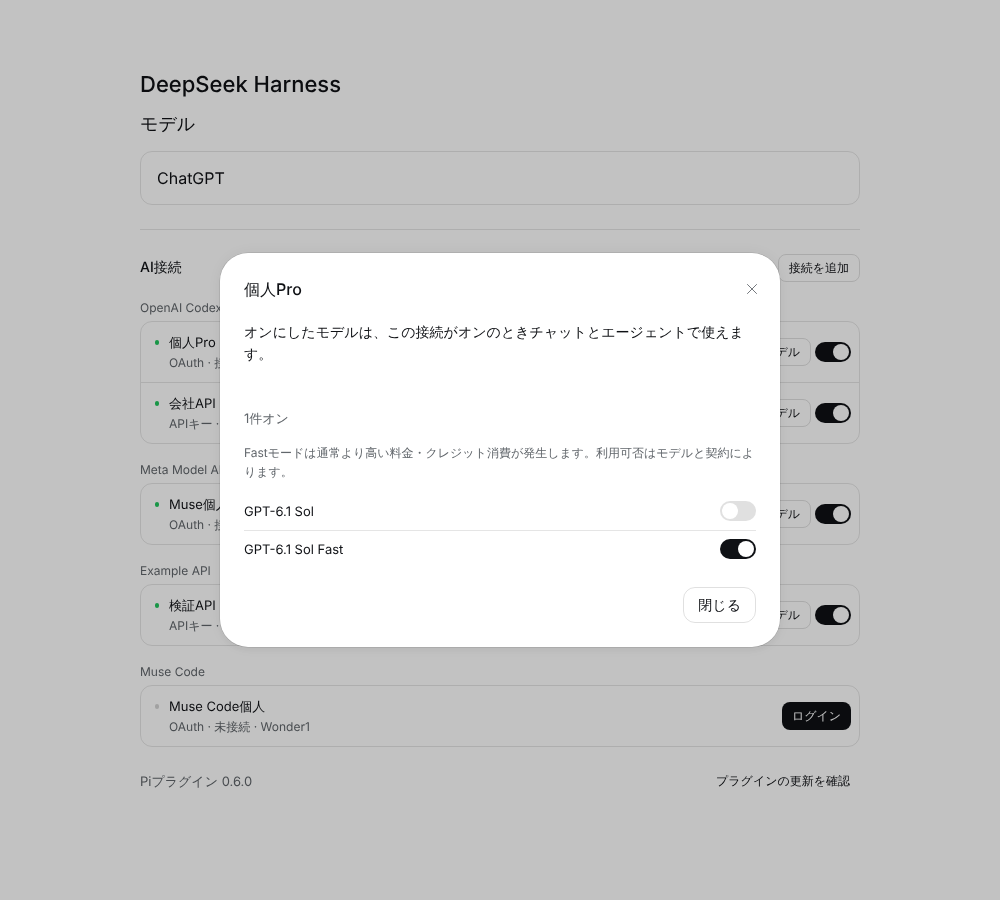
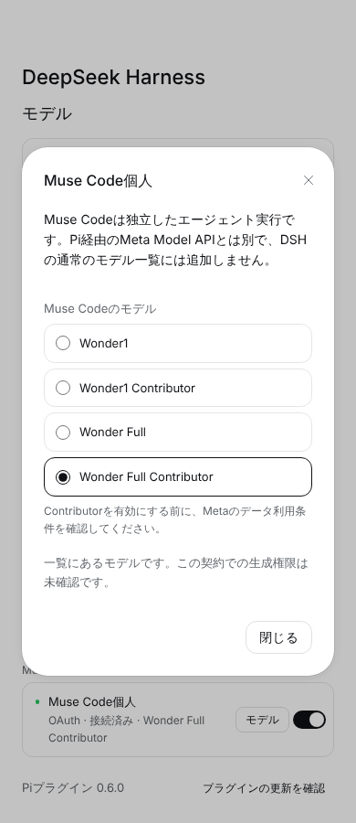
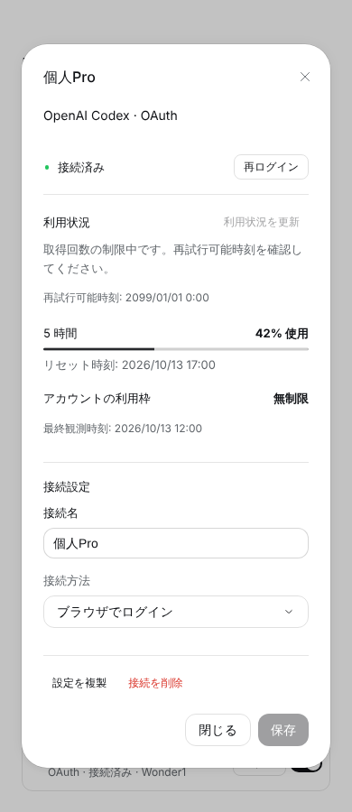

# 0.6.1 UI

Linux Chromiumで公式DSH UI部品を使ったfixtureの画面です。実アカウント・OS実機の証拠ではありません。

一覧を「接続名・認証方法・状態＋行のスイッチ」にまとめ、利用状況タブを廃止して接続ごとの画面に統合しました。OAuthの接続は追加後にそのままログインし、成功するとオンになります。Muse Codeのモデルは単一選択のリストで、選ぶとすぐ保存します。

| 画面 | |
| --- | --- |
| 一覧（390px / light、未ログインあり） |  |
| 一覧（390px / dark） |  |
| 一覧（1440px / light） |  |
| モデル選択 |  |
| Muse Codeのモデル |  |
| 接続の画面（状態・利用状況・設定） |  |
